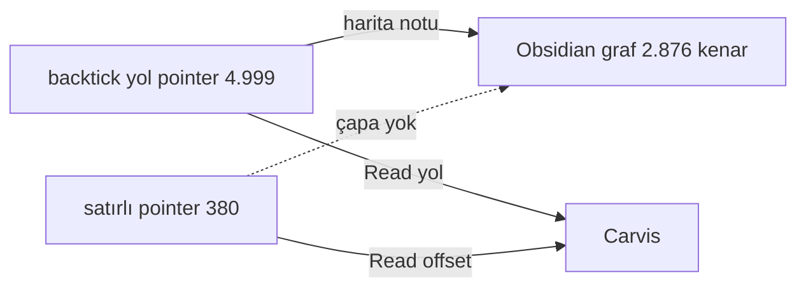

# İB-53 (1) — Görüntüleme katmanı kapsama haritası: D2 · Obsidian · silver/Carvis

**AS-OF 2026-08-29 · yan icra oturumu (Fable) · silver `27481f5` · İB-53 adım (1) (Karar 72 daraltması: üçlü "D2 · Obsidian"; QuickLook kolonu düştü) · Salih ilkesi 08-26: "araç bize uyar, biz araca uymayız"**

*Ne bu:* Jarvis'te bir OKUMA İHTİYACINI hangi yüzeyin karşıladığının ölçülü envanteri. Üç yüzey: **D2 grafı** ([graf/README.md](../graf/README.md); `tools/pointer-graf.py`), **Obsidian** (md açma yüzeyi, Karar 72; graf/backlink için türetilmiş harita notları, Karar 72 EK), **silver + Carvis araçları** (`veri/baglam.sqlite`, FTS5, Read offset/limit). Her sayı kaynaklı; Obsidian'ın kendi yetenekleri hakkındaki iddialar canlı doğrulanmadıysa `[AS-OF ≤ kesim, doğrulanmadı]` damgalı. Karar VERMEZ; §4 boşlukları ve §5 seçenekleri Salih'e sunar.

## 1. Taban sayımları (deterministik; kaynak: silver `dosya`/`referans` @ 27481f5 + git-izli md üstünde grep)

| Ölçü | Değer | Kaynak |
|---|---|---|
| md dosyası | **585** (sıcak 36 · ılık 94 · soğuk 455) | silver `dosya` |
| nokta-dizin altındaki md (`.claude/` skill/hook) | **20** — Obsidian gizli klasörü indekslemez; kapı `kaynak-kodu/` | silver `dosya` |
| arşiv md (`*arsiv*`) | 15 — harita notlarında KAYNAK olamaz (hedef olabilir) | silver `dosya`; `tools/obsidian-harita.py` kapsam kuralı |
| `dosya_pointer` referansı | **9.793** (çözümlü 8.487 · **kırık 1.306**) · 6.303 kayıtta · **544 md dosyada** | silver `referans` |
| `wiki_link` (`[[…]]`) | **264** · 76 md dosyada — Obsidian'ın DOĞRUDAN saydığı tek bağ türü | silver `referans`; grep 264/76 aynı |
| backtick yol pointer'ı (md gövdesi) | **satırsız 4.999 · satırlı (`yol:123`) 380** | grep, git-izli md |
| md içinde tablo / mermaid | tablo **301** dosya · mermaid **1** dosya | grep |
| Obsidian harita notları (türev, gitignore) | **13 küme · 487 kaynak dosya · 2.876 kenar** (silver 0612826) | `graf/obsidian-harita.md` indeksi (gitignore'lu türev; üretici [tools/obsidian-harita.py](../tools/obsidian-harita.py)) |
| D2 panoları | 5 tematik pano + tam + kırık panosu + **3 odak panosu** (KB-59 · rapor 08-22-1 kaydı · rapor 08-22-2 dosyası) + kenar listesi (LLM) | `graf/` dizini |
| Carvis erişim | kayit_id adresi (yol#satır#sha8) · FTS5 recall@5 **0,617** (n=100, 08-29) · `bag` 20 tipli bağ · karar-borcu pointer 320 (kırık 0) | `v_erisim_eval`, `v_bag_ozet`, karar-borcu-tablo |

## 2. Kapsama haritası — okuma ihtiyacı × yüzey

Gösterim: ✓ karşılıyor · ◐ kısmen/dolaylı · ✗ karşılamıyor · [?] doğrulanmadı.

| # | Okuma ihtiyacı (kim) | D2 grafı | Obsidian | silver / Carvis | Durum |
|---|---|---|---|---|---|
| R1 | md dosyasını açıp okumak (insan) | ✗ | **✓** Karar 72 (⌘O) | ✓ Read | kapalı |
| R2 | rapor biçimi: tablo (301 dosya) · mermaid (1) · `[[wikilink]]` · dipnot/details · `$matematik$` (insan) | ✗ | ✓ KILAVUZ Obsidian-uyum; mermaid/matematik "ilk raporda canlı doğrulanacak" şerhi hâlâ AÇIK **[?]** | — | kapalı (doğrulama borcu) |
| R3 | backtick yol pointer'ından hedefe gitmek — **4.999** satırsız (insan) | ✗ şema düzeyi | ✗ tıklanmaz (kod biçimi) · **◐ harita notu üzerinden dolaylı** (2.876 kenar, 487 dosya: graf/backlink panelinde görünür, gövdede tık yok) | ✓ Read yol | **BOŞLUK (insan, doğrudan)** |
| R4 | satırlı pointer `yol:123` (**380**) hedef satıra inmek (insan) | ✗ | ✗ satır çapası yok **[AS-OF ≤ kesim, doğrulanmadı]**; başlık çapası `[[dosya#başlık]]` var [aynı damga] | ✓ Read offset/limit · sed (Karar 62 adresli erişim) | **BOŞLUK (insan)** |
| R5 | bir dosyanın bağ topolojisi: kim işaret ediyor / neye (insan+LLM) | ✓ odak panosu (≤50 düğüm, 1-2 sıçrama; bugün 3 üretilmiş, istek üzerine) | ✓ graf + backlink (harita notlarıyla; **yalnız md↔md**, nokta-dizin 20 md ve arşiv-kaynaklar dışarıda, .py/.jsonl hedefleri düğüm değil) | ✓ `referans` sorgusu | kapalı (kapsam şerhli) |
| R6 | kırık pointer'ı görmek | **✓ kırık panosu** (1.306 kırık dosya_pointer, kaynak dosya → hedef) | ✗ yalnız `[[wikilink]]` için "unresolved" (backtick görünmez) | ✓ `hedef_var=0`; karar-borcu 0/320 | kapalı (Carvis/D2) |
| R7 | süpersede / zaman: hangi kayıt hangisini yeniledi, ne zaman (insan+LLM) | ✓ silver panosu `wasRevisionOf` kenarı (tip etiketli, 08-29) | ✗ | **✓ `bag`** (20: R1 anahtar-kaydı 10 · R3 damıtma→arşiv 10) + `anahtar_kaydi` bitemporal | kapalı (yeni, 08-29) |
| R8 | metin arama | ✗ | ✓ vault arama (insan; ölçülmedi) | ✓ FTS5 (recall@5 0,617 n=100; grep tabanı) | kapalı |
| R9 | sistemi tek bakışta görmek | **✓ genel pano** (9 kutu) | ◐ dosya-düzeyi graf 527 düğüm (okunurluk ölçülmedi) | ✓ kenar listesi (LLM) | kapalı |
| R10 | mobil okuma | ✓ SVG (tarayıcı) | **[?]** Obsidian mobil + vault senkron KURULMADI | ✗ | **belirsiz** (KB-34/mobil = yan-oturum) |
| R11 | `.claude/` skill/hook md'lerini okumak (**20** dosya) | ✗ | ✗ gizli klasör indekslenmez → vault'ta ölü | ✓ Read; insan: `kaynak-kodu/` symlink (Finder) | **BOŞLUK (Obsidian)** |
| R12 | türev/veri okumak: `veri/gorunum` CSV, `bronz` jsonl | ✗ | ✗ `userIgnoreFilters` (bilinçli: bronz/gorunum/parquet/claude-izler) | ✓ sqlite/CSV | kapalı (tasarım gereği) |

## 3. Okuma
- **İnsan tarafı Obsidian'la R1/R2/R5/R8/R9'u kapatıyor;** Carvis tarafı silver'la her satırı kapatıyor. Kalan boşluklar tamamen **insanın pointer'ı tıklayıp hedefe gitmesi** üzerinde: R3 (4.999 satırsız backtick — dolaylı görünür, doğrudan tıklanmaz), R4 (380 satırlı — hiçbir yüzey satıra götürmüyor), R11 (20 nokta-dizin md'si Obsidian'da yok).
- Boşluğun kökü Karar 72'de ölçülmüştü: pointer'ların backtick (düz metin) biçimi. Karar 72 EK (a) ileri-dönük md-link biçimini getirdi; harita notları geçmiş kütleyi GRAFİĞE soktu ama GÖVDEDE tık vermez — R3'ün "◐" olmasının nedeni bu.
- R2'nin mermaid/matematik doğrulaması 08-26'dan beri açık: bu rapor mermaid blok içeren 2. md dosyası olacak (aşağıda §6) — Salih Obsidian'da açınca doğrulama tek bakışta.

## 4. Boşluk özeti (İB-53 (2)'nin girdisi)
| Boşluk | Büyüklük | Kim etkileniyor |
|---|---|---|
| B1 satırlı pointer → satır | 380 pointer | insan (rapor okurken) |
| B2 satırsız backtick → tık | 4.999 pointer (544 dosya) | insan; dolaylı görünür |
| B3 nokta-dizin md'leri vault'ta yok | 20 dosya (skill/hook) | insan (Obsidian) |
| B4 mobil | — | Salih yolda |

## 5. Seçenekler (Salih kararı; her biri "araç bize uyar" sınırında — gövdeye dokunmaz, silver'dan türetir)

**(a) Harita notlarını BAŞLIK-çapalı ve satır-bilgili yapmak — ÖNERİLEN.**
- *Ne demek:* `tools/obsidian-harita.py` her kenarı `[[hedef#en-yakın-başlık]]` + "satır 123" metniyle yazar; silver `kayit.bolum_yolu`/`satir_bas` satır→başlık eşlemesini zaten taşıyor.
- *Ne yaparım:* script'e başlık çözümü + satır metni; hat adımı aynen; ilk koşumda Obsidian'da bir link tıklanıp başlığa indiği görülür (canlı doğrulama, damga kalkar).
- *Artı:* B1'i başlık düzeyinde, B2'yi dolaylı-ama-hedefli kapatır; deterministik (Karar 65), gövde değişmez (m.8), maliyet kod-sınıfı.
- *Eksi:* satıra değil başlığa iner; başlıksız uzun dosyalarda (jsonl/CSV) çözüm yok; Obsidian başlık-çapası davranışı doğrulanmadı [AS-OF ≤ kesim].
- *Gerekçe:* boşlukların %93'ü (B2) zaten dolaylı görünür; eksik olan "hedefe iniş" — başlık çapası bunu en ucuz kapatır.

**(b) Nokta-dizin md'lerini harita kapsamına almak (B3).**
- *Ne demek:* `kaynak-kodu/claude/...` symlink yolu üzerinden 20 skill/hook md'si harita notlarına düğüm olarak girer.
- *Ne yaparım:* obsidian-harita kapsam kuralına "nokta-dizin → kaynak-kodu/ yolu" eşlemesi; Obsidian'ın symlink'i takip edip etmediği ilk koşumda görülür [?].
- *Artı:* skill/hook belgeleri grafiğe girer (açık-kaynak ilkesi, CLAUDE.md §2). *Eksi:* symlink davranışı belirsiz; çift düğüm riski.

**(c) Geriye dönük backtick → md-link dönüşümü (İB-53 (3)).** Salih 08-26: "öncelik DEĞİL". *Artı:* B2 tam kapanır. *Eksi:* 544 dosya gövdesi değişir (m.8 gerginliği, büyük diff), silver pointer ayıklaması iki biçimi de tanıyor ama tarihçe kirlenir. Öneri: kapalı kalsın.

**(d) Hiçbir şey — bekle.** Boşluklar insan-tarafı konfor sınıfı; Carvis her satırı okuyabiliyor. *Artı:* sıfır iş. *Eksi:* raporlardaki 380 satırlı pointer Salih için elle arama olarak kalır.

## 6. R2 canlı doğrulama bloğu (Obsidian'da açınca görünmeli)

Matematik: $\text{kapsama} = \frac{2.876}{4.999 + 380} \approx 0{,}53$ (harita kenarı / backtick pointer; kaba oran — kenarlar tekilleştirilmiş çiftlerdir, pointer'lar tekrar içerir; m.29).

## 7. Ne değişti / ne değişmedi
- Değişen: İB-53 (1) KAPANDI (harita ölçülü); (2) seçenek (a)-(d) Salih'e; R2 doğrulama bloğu bu dosyada.
- Değişmeyen: kod yazılmadı; Obsidian ayarı değişmedi; hiçbir gövde dönüştürülmedi.
- Yeniden açma: Obsidian sürüm/davranış değişirse [?] satırları; Karar 72 EK (a) md-link biçimi yaygınlaşınca B2 kendiliğinden küçülür (ölçüm: `wiki_link`/md-link sayısı ↔ backtick sayısı, `v_referans_sayim`).
