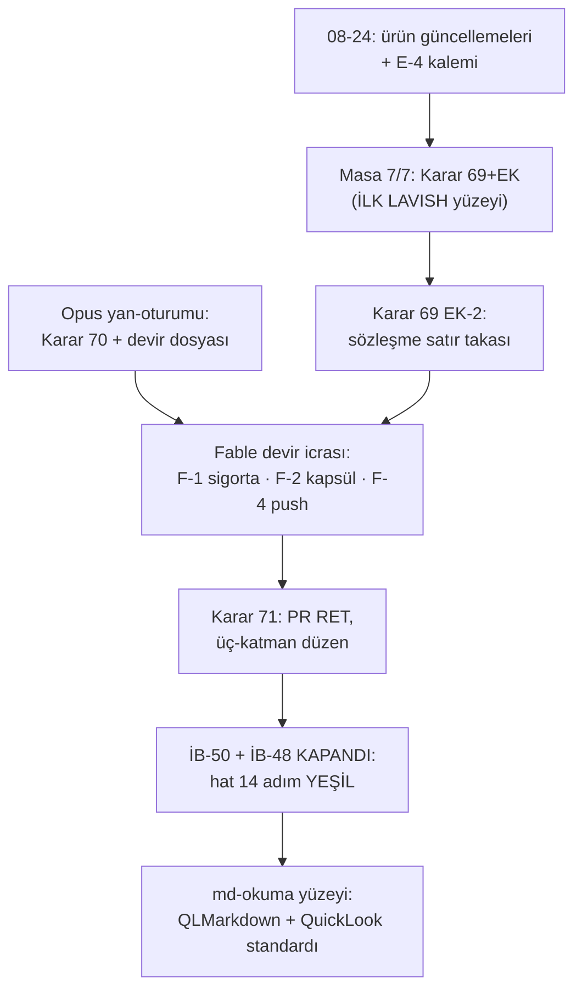

# Seans Teslim Raporu — 2026-08-26 seans-17 (lavish masası · Opus devri · ürün güncellemeleri)

*(Şablon: `core/sablonlar/seans-teslim.md`. AS-OF 2026-08-26 17:4x · yazan Carvis/Fable 5, ana-sıra · oturum 08-24 yarım turunun resume'u — İLK QuickLook-uyumlu teslim raporu: KILAVUZ tasarım-ilkeleri satırı, ölçüm tabanlı.)*

## 1. Bugün gerçekten ne değişti

- [x] **Kun-Chen ürün ailesi güncellendi:** no-mistakes 1.48→**1.57** · lavish-axi 0.1.50→**0.1.59** · gnhf 0.1.43→**0.1.45** · gh-axi 0.1.30→**0.1.33** · quota-axi 0.1.25→**0.1.30** · treehouse 2.1.1→**2.3.0**; MarkText cask kaldırılmış (elendi); npm 11→12 major atlaması Salih'te.
- [x] **İLK LAVISH KARAR MASASI:** KB-62..68 **7/7 hükme bağlandı** (yüzey `raporlar/masa-KB62-68-karar-yuzeyi-2026-08-26.html`; iki turda, notlar yapılandırılmış geldi).
- [x] **CLAUDE.md satır takası (KB-66 icra):** anakronizm-yasağı pointer'ı §6'da; A1+A2 çıktı (tam metin defterde; bilgi wiki + anahtar-kaydında yaşıyor); bütçe 7.163/7.168 B.
- [x] **Karar 70 sigortası:** `settings.json` ask += screencapture/rec/sox (ffmpeg DIŞARIDA — EK-Fable hükmü).
- [x] **İB-50 KAPANDI:** kosum-sonuc grain — additive `wf_id` + wf-köprüsü + bronz süpersede düzeltmesi (S-0) + çift-yollu test; **hat exit 0**.
- [x] **İB-48 3/3 KAPANDI:** `graf` adımı hatta (panolar + LLM metin-türevleri `tam.d2`/`kenarlar.txt` her koşumda; `tam.svg` render hatta girmez — Salih beyanı: "o dosya llm için, bir şeyini değiştirme"); 6+1 pano tazelendi, Chrome'da teslim edildi.
- [x] **KB-67a icra:** anakronizm lint hatta UYARI-kanallı adım (İHLAL düşürmez, sayılır; `UYARI_KODLARI` mekanizması).
- [x] **md-okuma yüzeyi:** QLMarkdown canlı md.33 verisiyle seçildi (brew 30g 3.603 · 1.5.2/2026-06-30) + Quick Look testi koştu + **QuickLook-uyum rapor standardı KILAVUZ'da** (ölçüm: mermaid ÇALIŞIYOR · math/wikilink YOK) — bu rapor ilk uygulaması.
- [x] **Obsidian eksisiz-artı:** graf renk grupları (`.obsidian/graph.json`, yerel — gitignore'da) + Opus okuma-modu baki; kanonik pointer AĞI D2 panoları kaldı.
- [x] **Opus devri alındı ve icra edildi** (`kuyruk/devir-2026-08-26-seans17-fable.md`): F-1 ✓ F-2 ✓ F-3 çakışmasız-zaten-bitmişti F-4 push ✓ (b4be474..7e7027b, 21 commit); m.41 GK-2 devir deseninin İLK tam koşumu.
- [x] İB-51 (kural-kümeleme) · İB-52 (KB-68 icra paketi) · İB-53 (pointer-uyumlu görüntüleme, REVİZE: araç-bize-uyar) açıldı.

## 2. Kararlar (kaynak + gerekçe + geri-açma → defter)
| Karar | Hüküm | Geri-açma |
|---|---|---|
| **69 + EK** | KB-62..68 → a/a/a/b/a/a/a (lavish yüzeyinden; KB-63 şerhli: Go'ya geçiş OTOMATİK DEĞİL) | KB-65: hook gecikme büyürse · KB-67: lint sertleşmesi ölçümle |
| **69 EK-2** | satır takası "1 + bilgi ulaşılabilir" — A1+A2 arşivli çıktı | — |
| **70 EK (Fable)** | ffmpeg ask-listesi DIŞINDA (dar kapsam) | ihtiyaç doğarsa tek satır |
| **71** | PR-per-chat RET; üç-katman çok-oturum düzeni KILAVUZ'da | — |

## 3. ADAY kalan (karar değil)
- Pretool-tel kalıp ince-ayarı (Opus + Fable aynı yanlış-pozitifi bağımsız yaşadı; desen adayı devir §Not'ta).
- `.obsidian` gitignore'da ↔ gizli-klasör kuralı (§2) ilişkisi — Salih hükmü.
- E-4 masası HAZIR, Salih ertelemesiyle bekliyor ("yeni karar masasına şu an geçilmeyecek").

## 4. Sonraki ilk iş
1. **Carvis:** İB-52 kalanı (kayit tablosuna `cekim_tarihi`/`kaynak_tarihi` + kapanışa N=3 tazeleme) · İB-53 kapsama haritası.
2. **Salih tetikleri:** E-4 masası (KB-63 çözüldü) · İB-51 atlası · **DAMITMA (boyut-tetiği 4 dosya):** kutu 28,9/20 · KILAVUZ 20,5/16 · defter 62,9/48 · pano 13,2/12.

## 5. Yeniden-açma koşulları
KB-65 (hook: gecikme/sayı büyümesi) · KB-67 (lint sertleşmesi: seans-başına İHLAL ölçümü + ders) · KB-63 Go kolu (T1 dış-makine tetiği → parite testi → **Salih masası**, otomatik değil).

Hasat + sayaçlar + kontrol listesi (6e)

**Özütler:** (1) Lavish masa yüzeyi 7 Katman-1 kararını 2 turda yapılandırılmış indirdi — sonraki masalar aday. (2) Vaka-5: çıplak `git commit` index'i süpürür → pathspec-commit SOP. (3) Rapor standardı tahminle değil ölçümle kuruldu (`qlmarkdown_cli` render testi). (4) m.41 GK-2 devir deseni ilk tam koşumda çakışma 0 üretti. (5) Hat-adımı tarifi dar kalınca türev bayatlıyor (tam.d2 vakası — Salih yakaladı); "hat her türevi tazeler" ilkesi.

**wiki-delta (kuyruğa):** `wiki/paralel-oturum-protokolu.md` ← Karar 71 üç-katman düzeni.

**Sayaçlar:** silver-sağlık KAPI=0 (WARN: T-C3-ılık 112 bilinen; kuyruk: YETİM 221 · KAPANDI 30 · T-A 500/6467) · skill-eşik 6 çift, yeni sapma 0 · kural 19/100 · anakronizm hat-içi UYARI (taban rejimi, KB-67a).

**Kontrol listesi:** (1) karar/kural adayları ingest'e girdi ✓ (defter+ledger+kutu-gereksiz) · (2) açık pipeline yok — masa 7/7 kapandı, lavish oturumu kullanıcı kapattı ✓ · (3) Workflow koşmadı → KB-02 kaydı yok ✓ · (4) paralel oturum: Opus devri + vaka-5 kaydı ✓.

**Token×zaman:** çok-günlü resume (08-24 → 08-26 17:4x); bugünkü aktif dilim ~10:00-17:45; Workflow 0; ayrıntı `v_baglam_seyri` + hareket günlüğü 08-26.

